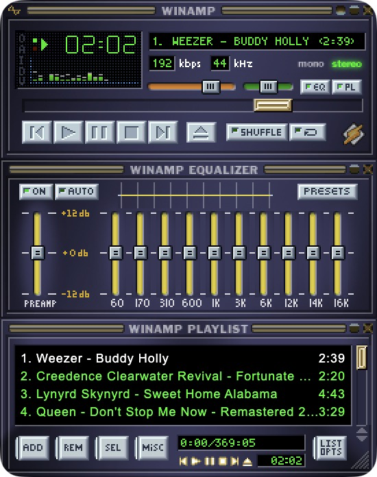

<p align="center"></p>

# Spotamp

Classic Winamp 2 as a Spotify player for macOS. It lives in the menu bar and
pops up on a global hotkey. The equalizer changes the real sound, and the
visualizer dances to it.

<p align="center"></p>

Built on [Webamp](https://github.com/captbaritone/webamp), the Winamp 2
reimplementation for the web, and [librespot](https://github.com/librespot-org/librespot).

## Features

- **Pops up on a hotkey.** <kbd>⌃⌥W</kbd> shows and hides a frameless widget
  that floats above other windows and follows you across Spaces. Drag it by
  any Winamp title bar.
- **Your library in the playlist.** Liked Songs by default. Pick any of your
  own playlists from the ♫ menu in the menu bar.
- **A real equalizer.** The 10 bands and the preamp process the actual audio,
  not a visual effect.
- **A real visualizer.** Webamp's spectrum and oscilloscope draw the sound
  coming out of your speakers.
- **Familiar controls.** Play, pause, next, previous, the seek bar and the volume
  slider all control Spotify. Double-click a row to play it.
- **Plays nicely with Spotify.** Spotamp shows up as a Spotify Connect device
  named “Spotamp”. Switch to it from the Spotify app or your phone, and the
  widget follows.

## How it works

```
Spotify ──► librespot ──► Spotamp engine ──► speakers
            (Connect      (equalizer,        (CoreAudio)
             device)       volume, pause)
                               │
                               └──► Webamp visualizer
```

librespot receives the stream as a Spotify Connect device. The engine applies
the Winamp equalizer and volume and passes the sound to CoreAudio. Webamp
shows the interface and sends its controls to the Spotify Web API.

## Install

1. Download `Spotamp-<version>-arm64.dmg` from
   [Releases](https://github.com/alver714/spotamp/releases) and drag Spotamp
   to Applications.
2. The app isn't notarized by Apple, so macOS blocks the first launch. Open it
   once, then go to **System Settings → Privacy & Security** and click
   **Open Anyway** next to Spotamp.
3. Follow the setup window. It takes about two minutes, once.

### Requirements

- macOS on Apple Silicon
- **Spotify Premium** (librespot can't play on free accounts)
- A free Spotify developer app, created during setup

### Setup, step by step

Spotify only lets third-party players use the Web API through an app that you
register yourself, so Spotamp asks you to create one:

1. Open the [Spotify Developer Dashboard](https://developer.spotify.com/dashboard)
   and create an app with any name.
2. Add the redirect URI `http://127.0.0.1:5174/callback` and tick **Web API**.
3. Copy the app's **Client ID** into Spotamp and sign in.
4. Click **Connect** to sign in the player engine (librespot) once more.

Your Client ID, tokens and engine credentials stay on your Mac, in
`~/Library/Application Support/Spotamp`.

## Good to know

- **Other people's playlists are greyed out.** Spotify doesn't give apps in
  development mode the tracks of playlists you don't own. Your own and
  collaborative playlists work.
- **Developer apps are limited to a few users.** If you share your Client ID,
  add each person under *User Management* in the dashboard. It's easier for
  everyone to create their own app.
- **librespot is an unofficial Spotify client.** Spotify tolerates it, but it
  isn't approved by Spotify. Use it at your own risk.
- **The hotkey** can be changed with the `SPOTAMP_HOTKEY` environment variable,
  for example `Command+Shift+Space`.

## Build from source

```bash
brew install librespot
npm install
npm run vendor   # builds native/pcm-out.swift and copies librespot into vendor/
npm start        # run in development
npm run dist     # build dist/Spotamp-<version>-arm64.dmg
```

`SPOTAMP_DEBUG=1 npm start` prints the engine logs, including where each track
switch starts.

## Credits

Spotamp stands on [Webamp](https://github.com/captbaritone/webamp) by Jordan
Eldredge and [librespot](https://github.com/librespot-org/librespot). See
[THIRD_PARTY_NOTICES.md](THIRD_PARTY_NOTICES.md).

Winamp is a trademark of its owner. Spotamp is not affiliated with Winamp,
Llama Group or Spotify.

## License

[MIT](LICENSE)
